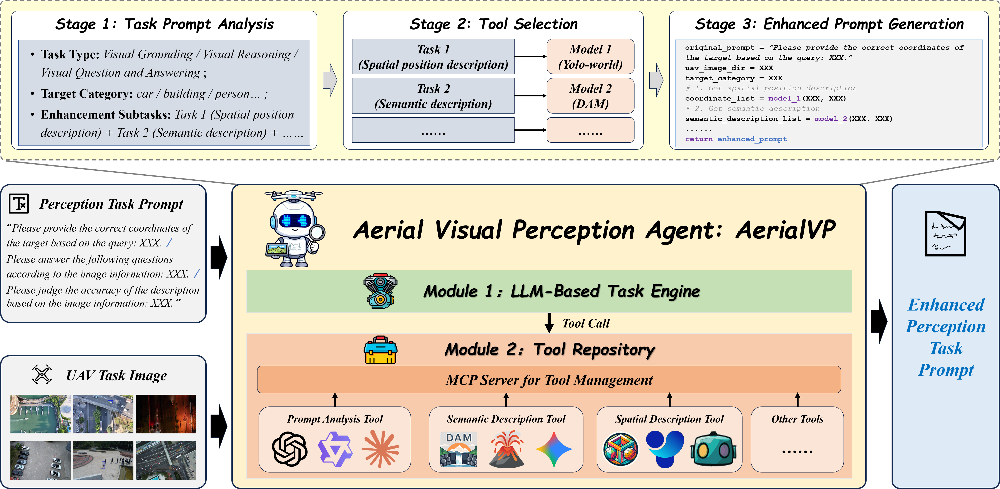

# AerialVP: Towards Accurate UAV Image Perception——Guiding Vision-Language Models with Stronger Task Prompts
This project introduces **AerialVP (Aerial Visual Perception)**, an agent framework that **automatically enhances task prompts** for UAV image understanding with Vision-Language Models (VLMs). AerialVP analyzes the input task, selects suitable tools from a modular repository, and generates **refined, information-enriched prompts** to support perception, reasoning, and grounding in aerial imagery. The project also provides **AerialSense**, a unified benchmark suite covering **Aerial Visual Reasoning**, **Aerial Visual Question Answering**, and **Aerial Visual Grounding**, enabling standardized evaluation across diverse UAV scenarios.

<p align="center" width="100%">
  
</p>

# 🚀 Framework Setup and Usage

## How AerialVP works

AerialVP enhances task prompts **before backend VLM inference**. It contains two core modules:

- **Task Engine:** analyzes the task type and relevant objects, selects enhancement tools, and generates an executable Python workflow.
- **Tool Repository:** exposes prompt-analysis and visual-perception tools through the Model Context Protocol (MCP).

The workflow extracts spatial positions, semantic attributes, and spatial relationships as required by the task, then combines them with the original instruction. The enhanced prompt and original image can be passed to the backend VLM without changing its architecture or weights.

<p align="center">
  
</p>

Before execution, the engine validates tool names, argument schemas, dependencies, and generated code against the selected tool plan. Invalid instructions are returned to the engine with error feedback for regeneration. Successful results enter the execution history and inform subsequent decisions.

## 1. Install dependencies

Use a source checkout and an editable installation. **Python 3.10** is recommended. The default visual pipeline requires an NVIDIA CUDA GPU; DAM is not supported in CPU-only mode. Install Git for the OpenAI CLIP dependency.

```bash
git clone https://github.com/lostwolves/AerialVP.git
cd AerialVP
python -m venv .venv
```

Activate the environment:

| Platform | Command |
|---|---|
| Linux shell | `source .venv/bin/activate` |
| Windows PowerShell | `.\.venv\Scripts\Activate.ps1` |

Install PyTorch for your CUDA setup, followed by AerialVP. The following configuration uses CUDA 12.1:

```bash
python -m pip install --upgrade pip
python -m pip install torch==2.5.1 torchvision==0.20.1 --index-url https://download.pytorch.org/whl/cu121
python -m pip install -e ".[models,test]"
```

The `models` extra installs OpenAI CLIP from its official Git repository. Main dependency versions are:

| Component | Version / constraint |
|---|---|
| PyTorch / torchvision | 2.5.x / 0.20.x |
| Transformers | 4.51.3 |
| Ultralytics | 8.3.113 |
| MCP Python SDK | >=1.12, <2 |
| SentencePiece | 0.2.0 |
| NumPy / OpenCV | <2 / >=4.8, <4.12 |
| bitsandbytes | >=0.45, <0.49 |

The complete dependency list is in [pyproject.toml](pyproject.toml). The `test` extra provides pytest. A core-only editable installation, `python -m pip install -e ".[test]"`, supports the protocol tests without installing visual models.

## 2. Configure the API

Create a local environment file:

```bash
python -c "from shutil import copyfile; copyfile('.env.example', '.env')"
```

Set the values in `.env`:

```dotenv
OPENAI_API_KEY=your_api_key
AERIALVP_CHAT_COMPLETIONS_URL=https://api.openai.com/v1/chat/completions
```

The URL must be the **complete Chat Completions endpoint**. For a compatible provider, replace it with that provider's endpoint and configure model IDs supported by the provider.

The default configuration follows the paper:

| Role | Default model |
|---|---|
| Task Engine | GPT-4.1 |
| Prompt-analysis tools | GPT-4o |
| Optional backend inference | GPT-4.1 |

To customize model names, device placement, or checkpoint paths, copy `configs/local.example.json` to `configs/local.json`, edit the relevant fields, and pass `--config configs/local.json` **before** the CLI subcommand. Nested settings inherit from `configs/default.json`.

The API key is read from the environment or `.env`; it is not stored in run manifests. Local environment files, model checkpoints, and run outputs are excluded by `.gitignore`.

## 3. Download model checkpoints

Download the main pipeline:

```bash
python scripts/setup_models.py --models yoloworld clip dam sam spaceom
```

Download alternative tools when needed:

```bash
python scripts/setup_models.py --models grounding_dino llava15 llava_onevision
```

| Function | Model | Default checkpoint location |
|---|---|---|
| Spatial position | YOLO-World-X | `models/yoloworld/yolov8x-world.pt` |
| YOLO text encoder | OpenAI CLIP ViT-B/32 | `models/clip/ViT-B-32.pt` |
| Semantic description | DAM-3B-Self-Contained | `models/dam/` |
| DAM region masks | SAM ViT-H | `models/sam/` |
| Spatial relationships | SpaceOm | `models/spaceom/` |
| Alternative detector | Grounding-DINO Tiny | `models/grounding_dino/` |
| Alternative descriptions | LLaVA-1.5-7B | `models/llava15/` |
| Alternative descriptions | LLaVA-OneVision-7B | `models/llava_onevision/` |

Model paths resolve relative to the repository root. Existing checkpoints can be reused by editing their paths in a local configuration. The downloader records Hugging Face commit revisions or file checksums alongside each checkpoint.

Visual models run in separate worker processes and release their GPU allocations when the processes exit. SAM and DAM are loaded sequentially. The two 7B alternatives use NF4 4-bit quantization by default; memory needs also depend on image size and generation length. See [model setup notes](docs/models.md) for upstream sources and configuration details.

## 4. Check the installation

```bash
python -m aerialvp.cli doctor
python -m aerialvp.cli list-tools
python -m aerialvp.cli probe-api
```

- `doctor` reports dependency versions, checkpoint availability, and whether an API key is configured.
- `list-tools` starts the MCP servers and lists their 11 tool interfaces.
- `probe-api` sends small requests to the configured engine and analysis models.

MCP servers start automatically; no separate daemon or public network port is required.

## 5. Generate an enhanced prompt

Provide an image and its original task instruction:

```bash
python -m aerialvp.cli enhance --image "data/uav_image.jpg" --prompt "Locate the black car parked in front of the building and return its bounding box coordinates." --run-dir "runs/example"
```

For longer or multiline instructions, use a UTF-8 text file:

```bash
python -m aerialvp.cli enhance --image "data/uav_image.jpg" --prompt-file "examples/grounding_prompt.txt" --run-dir "runs/example"
```

Replace the example image path with your own image. Use a new run directory for each task. If `--run-dir` is omitted, a timestamped directory is created under `runs/`.

The enhanced prompt is written to **`runs/example/enhanced_prompt.txt`**. The run also saves:

| File | Contents |
|---|---|
| `manifest.json` | Original input, task analysis, tool plan, and model settings |
| `engine_trace.json` | Engine decisions, validation feedback, and execution history |
| `enhance_program.py` | Executable workflow generated by the Task Engine |
| `tool_outputs.json` | Tool arguments and visual outputs |
| `enhancement_result.json` | Structured result including the enhanced prompt |

Prompt examples for visual grounding, visual reasoning, and visual question answering are available in [examples/](examples/). Bounding boxes use original-image pixel coordinates in `[x1, y1, x2, y2]` order.

## 6. Generate a program, then run it

To inspect the generated workflow before visual-tool execution:

```bash
python -m aerialvp.cli prepare --image "data/uav_image.jpg" --prompt-file "examples/grounding_prompt.txt" --run-dir "runs/example"
python runs/example/enhance_program.py
```

The second command runs the selected visual tools and produces the enhanced prompt without repeating GPT planning calls. Keep `enhance_program.py` and its adjacent `manifest.json` together. They describe a specific image and instruction; prepare a new workflow when either changes.

## 7. Use the enhanced prompt with a backend VLM

Pass the enhanced prompt **and the same original image** to your inference model. The optional CLI helper uses the configured Chat Completions backend:

```bash
python -m aerialvp.cli infer --image "data/uav_image.jpg" --prompt-file "runs/example/enhanced_prompt.txt" --output "runs/example/backend_answer.json"
```

Use `--model MODEL_ID` with `infer` to choose another backend model. Enhancement and final task inference are separate operations.

## Alternative tools and advanced configuration

The repository includes configurations for swapping visual tools:

```bash
python -m aerialvp.cli --config configs/grounding_dino.json enhance --image "data/uav_image.jpg" --prompt-file "examples/grounding_prompt.txt"
python -m aerialvp.cli --config configs/llava15.json enhance --image "data/uav_image.jpg" --prompt-file "examples/grounding_prompt.txt"
python -m aerialvp.cli --config configs/llava_onevision.json enhance --image "data/uav_image.jpg" --prompt-file "examples/grounding_prompt.txt"
```

The LLaVA configurations replace both semantic and relationship descriptions. The Grounding-DINO configuration replaces spatial-position detection.

If object regions are already available, pass `--regions path/to/regions.json` to `prepare` or `enhance`. The JSON format is:

```json
{
  "image_size": [1920, 1080],
  "objects": [
    {"id": "car_1", "category": "car", "bbox": [100, 200, 250, 300], "confidence": 1.0}
  ]
}
```

Image dimensions and coordinates must match the input image. Detection may also run as a prerequisite for semantic or relationship tools even when positions are not selected for prompt fusion.

## Tests and troubleshooting

```bash
python -m pytest -q
```

The automated tests cover planning, validation and regeneration, prompt preservation, configuration inheritance, and real MCP stdio communication. They do not require API access or model weights.

To run an individual visual model after downloading its weights:

```bash
python scripts/smoke_models.py --model yoloworld --image "data/uav_image.jpg" --objects car building
python scripts/smoke_models.py --model dam --image "data/uav_image.jpg" --positions "work/smoke_yoloworld.json"
```

Results are saved under `work/`.

- **API errors:** use `probe-api` to check the configured endpoint, credentials, and model availability. HTTP 5xx responses can require recovery by the API provider; the engine's instruction-validation loop does not repair service outages.
- **Missing weights:** check `doctor` and confirm checkpoint paths match the download destinations. Model inference uses local checkpoint files.
- **GPU memory:** run one task at a time, adjust image/token limits, or enable supported quantization in a local configuration.
- **Prompt templates:** see [prompt sources](docs/prompt_sources.md) for the paper examples, expanded tool guidance, and engine meta-prompts.

## Repository layout

```text
AerialVP/
├── configs/          # Paper configuration and alternative tools
├── docs/             # Model setup and prompt sources
├── examples/         # Task instruction examples
├── imgs/             # Framework and dataset figures
├── scripts/          # Model downloads and inference checks
├── src/aerialvp/
│   ├── engine.py     # Task Engine
│   ├── repository.py # MCP client and tool discovery
│   ├── server.py     # MCP prompt-analysis and visual-tool servers
│   ├── prompts.py    # Analysis, guidance, and fusion templates
│   ├── runtime.py    # Generated-program execution
│   └── model_adapters/
├── tests/
├── .env.example
└── pyproject.toml
```

# 📦 AerialSense Dataset

**AerialSense** is a large-scale UAV perception benchmark curated from multiple public UAV sources and organized under a unified evaluation protocol. It is designed to support **comprehensive, diverse, and realistic** assessment of multimodal perception in aerial settings.

<p align="center" width="100%">
  
</p>

### 🧭 Multi-Task Coverage
AerialSense jointly supports three core UAV perception tasks within a single benchmark:
* 🧠 **Aerial Visual Reasoning (VR)**
* ❓ **Aerial Visual Question Answering (VQA)**
* 🎯 **Aerial Visual Grounding (VG)**

### 📊 Scale & Density
* 🖼️ **7,119** UAV images
* 🧪 **53,374** task samples
  This high task density enables stable and systematic evaluation across multiple capabilities.

### 🧩 Rich Annotations for Grounding
For grounding-oriented evaluation, AerialSense includes **fine-grained referring expressions** paired with object localization annotations, emphasizing:
* 🎨 **semantic attributes** (e.g., color, category)
* 📍 **spatial cues** (e.g., orientation/relative position)
* 🔗 **relational descriptions** (e.g., “next to”, “in front of”)

### 🏷️ Broad Object & Scene Diversity
AerialSense covers **40 object categories** and diverse target types, including:
* 🚗🚶 **terrestrial moving objects** (cars, pedestrians)
* 🏢🅿️ **stationary structures/regions** (buildings, parking lots)
* 🚢 **waterborne moving objects** (ships)
  It supports evaluation across **terrestrial and aquatic scenes** with varied operational contexts.

### 🛰️ Multi-Resolution UAV Imagery
AerialSense includes images spanning a wide resolution range (approximately **512×512 to 4000×2250**), enabling robust testing of:
* 🔎 **multi-scale perception**
* 📷 **detail-sensitive recognition and localization**

### 📝 Instruction Richness
Task instructions are designed to be **information-rich and reasoning-oriented**, with an average length of **20.76 words** and substantial coverage of:
* object attributes
* spatial relations
* functional states
  This encourages deeper language–vision alignment beyond short keyword-style prompts.

### 🌦️ Realistic Visual Variations
To reflect real UAV conditions, AerialSense incorporates broad visual variation in:
* 💡 illumination
* 🧩 scene complexity
* 🛰️ resolution
  supporting fair evaluation of model adaptability and generalization in real-world aerial perception.

# Release Notes

* **[2026/11/11]  🚀 Code Release: AerialVP and Deployment Guide**
  We have released the AerialVP framework code, including the Task Engine and MCP-based Tool Repository. We also provide a deployment guide covering environment setup, model downloads, API configuration, and examples for generating and running prompt-enhancement workflows.

* **[2025/12/23]  📢 Dataset Release: AerialSense on Hugging Face**
  We have released the AerialSense dataset on Hugging Face: https://huggingface.co/datasets/GuoMN/AerialSense. The dataset covers three UAV perception tasks: Aerial Visual Reasoning, Aerial Visual Question Answering, and Aerial Visual Grounding. The Aerial Visual Grounding task is mainly built upon samples from original data sources, while a limited number of samples lacking grounding instructions are manually annotated by our team. The Aerial Visual Reasoning and Aerial Visual Question Answering datasets are manually constructed and validated. If you have any questions or concerns regarding the data, please feel free to contact us.

# Citation

If you find our work useful in your research, please cite our paper:

```
@article{guo2025towards,
  title={Towards Accurate UAV Image Perception: Guiding Vision-Language Models with Stronger Task Prompts},
  author={Guo, Mingning and Wu, Mengwei and Li, Shaoxian and Li, Haifeng and Tao, Chao},
  journal={arXiv preprint arXiv:2512.07302},
  year={2025}
}
```
